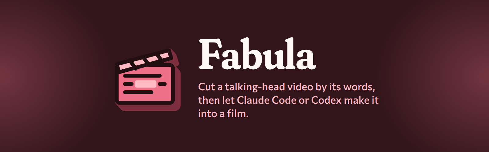
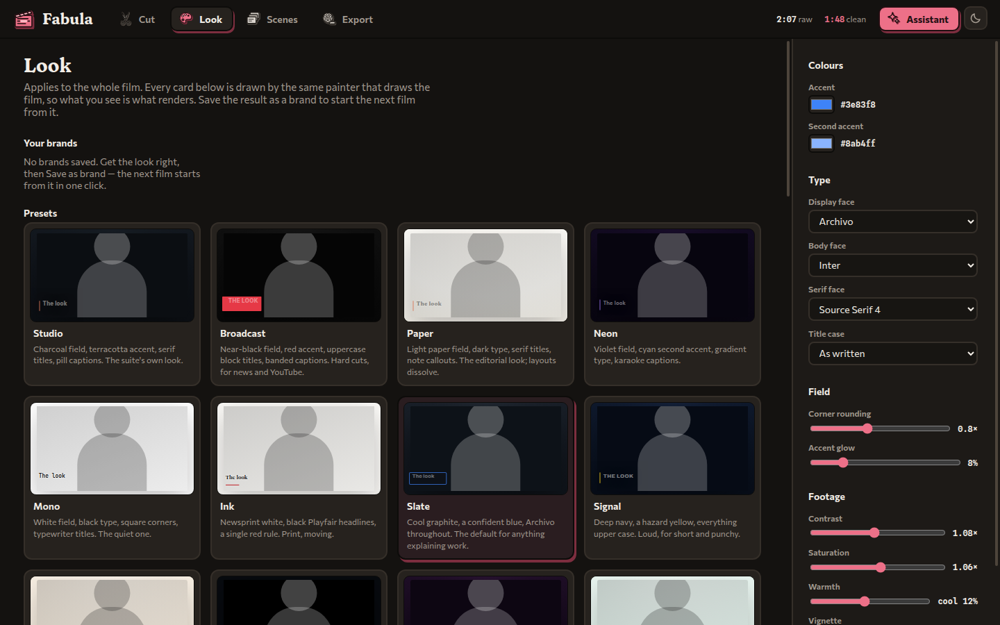
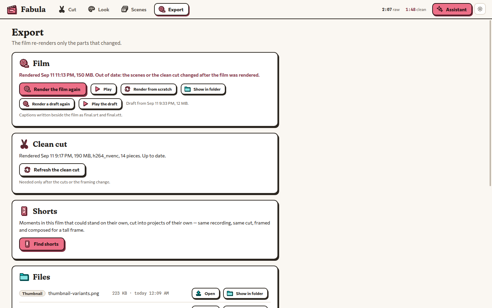

<p align="center"></p>

# Fabula

Cut a talking-head video by its words, then let Claude Code or Codex make it into a film.

Fabula is a transcript-driven talking-head video editor. It transcribes a recording locally
(WhisperX on CUDA), proposes cuts for dead air, fillers and false starts, and shows every cut as
strikethrough text for you to review before anything renders. Then it plans and composites visuals
around the speaker: layouts that move the head around the frame, named graphics, and motion scenes
the assistant writes as code. The assistant is Claude Code or Codex, on your existing subscription.
**Make it into a video** takes a reviewed cut to a draft film from a short brief. Fabula also makes
**motion films**, pieces that are nothing but motion graphics, with no recording.

<p align="center">
  
  
</p>

The window follows the system's dark or light; the control at the top right pins one.

## Run it

Fabula 0.3.1. **Fabula is a Windows app that needs WSL.** Its window runs on Windows; its
transcription (WhisperX on CUDA), its renders (ffmpeg, a headless Electron) and its assistant's
sessions are Linux programs, and WSL is where they run. macOS is not supported, and on Linux Fabula
runs only from a source checkout, for development: there is no Linux release.

To develop, you need Node 22 or newer, and Claude Code or Codex installed and signed in for the
assistant.

```bash
npm install
npm test              # node --test test/*.test.mjs; pure node, no media tools needed
npm run setup:tools   # static ffmpeg and a WhisperX venv under tools/, no sudo
npm start             # Electron window
```

In the Instrumenta launcher, an installed release runs the editor from an engine set up in your
default WSL distribution, and a workspace checkout runs as is. Details are under
[In the Instrumenta launcher](#in-the-instrumenta-launcher). Read
[`docs/product-brief.md`](docs/product-brief.md) for the pipeline, the architecture and the
decisions already made.

## Projects

The home screen has **New project…** (Ctrl+N, or drop a recording on the window) and the list of
projects you already have. A project is a recording where it lives plus what Fabula makes from it
(transcripts, cuts, scenes, renders) in a folder of its own. Nothing is copied.

A new project asks for the recording, a name, and the delivery shape: **Landscape** (16:9, 1920×1080)
or **Vertical** (9:16, 1080×1920, for Shorts, Reels and TikTok). The clean cut and every layout
follow from the shape; `set_format` changes it later and says what that costs. The name shows in the
masthead and the project list and can change any time, because the folder on disk is a slug that
never has to move.

Click the project's name in the masthead to rename it, show its folder, close it (Ctrl+W) or open the
full list (Ctrl+Shift+O). From the list you can also remove a project: it goes to the Recycle Bin, or, for a project
inside WSL (which has none), is deleted for good after Fabula asks. The recording is never
touched. The assistant has the same view through `list_projects`, `open_project`,
`switch_project`, `rename_project` and `close_project`.

The Projects window shows where everything is: the projects folder, and under **Where Fabula is
installed**, the program and the engine, each a click from Explorer.

Projects live in `media/` beside the checkout unless you choose another folder with **Change…**,
your Windows Videos folder included; Fabula offers to move existing projects and saved themes. The
choice is kept in the gitignored `fabula.settings.json` as the path WSL sees (`/mnt/c/Users/…`). A
Windows-side folder works, but renders are written to it through WSL, which is slower than the
checkout's own disk.

## Choose your assistant

**Assistant** in the top bar opens a sheet for the provider (Claude Code or Codex), the model and
the reasoning effort. Claude Code's aliases are listed, and for Codex the models your account can
use, read from the CLI's own cache; either accepts a custom model ID. The sheet also sets who the
session works as: the **Editor**, cutting for someone who chose to watch, or the **Short-form
farmer**, cutting for a feed (a short-form project suggests the farmer). **Start** opens the session
in a terminal pane inside the window, and its header names exactly what was started.

The CLI runs on the pipeline host inside a real pseudo-terminal (`scripts/pty-bridge.py`, standard
library only), with the sheet's choices passed as plain arguments to `scripts/assistant-run.sh`.
Hiding the pane leaves the session running; Stop ends it. The same launcher runs from a terminal in
this folder:

```bash
npm run assistant                                         # asks provider, model and effort
npm run assistant -- --saved                              # repeat your last selection
npm run assistant -- --provider claude --model fable --effort high
npm run assistant -- --provider codex --dry-run           # inspect without starting or saving
npm run assistant -- --persona farmer                     # work as the short-form farmer
```

It connects Fabula's MCP tools for that session only and leaves global configuration alone; a Claude
session gets only the `fabula` server. Preferences live in the gitignored
`.assistant-preferences.json`, and a session lock stops two launchers controlling the checkout at
once. To switch assistant, exit and start again: cuts, scenes and manual edits stay in the project,
conversation history does not.

Both assistants start from the same brief, held in `core/assistant-brief.mjs` and delivered through
the CLI's system prompt or first message, `CLAUDE.md` and `AGENTS.md`, and the MCP server; a test
fails if the copies drift. They follow [the same editing workflow](docs/assistant-workflow.md).

## The working loop

The window is where you watch and tweak; the assistant does the work. Both write to the same
project files, so neither tramples the other.

1. **Start a project.** Name it and give it the recording. Creating the project starts the first
   pass: transcription on the GPU, a scan for where the head sits, and proposed cuts (pauses,
   fillers, a preamble before the film promises anything, a false start, a stutter, a retake).
2. **Review the cut.** In the Cut step, click a struck word or pause to keep it, drag across words to
   cut them, and use ctrl+F to find a phrase. When the cut is right, press **Make it into a video…**
   and write a short brief: what the film is for, how closely to hold to the house style (**Free
   hand**, **Guided** or **By the book**), the look, whether music, sound effects and web pictures
   are allowed, and any notes.
3. **The assistant makes a draft.** It renders the clean cut, writes a treatment, sets the look,
   composes the scenes (moving the head between the full frame, a corner, a side column, a split
   screen and gone), writes motion scenes where a moment has to move, sets the sound, reviews its
   own work and renders a draft. The Making panel follows it phase by phase; **Watch the draft**
   plays it in the window. The real render waits for you. **Compose it with me instead** keeps the
   step-by-step path, composing with you in the pane.
4. **Iterate by prompting.** "Make the intro title punchier", "put the Godot logo next to where I
   mention it". The assistant reads the current plan and theme first, changes only what you asked,
   and re-renders behind the gate.

The top bar has four numbered steps (Ctrl+1 to 4):

- **Cut**: skip-preview playback, struck words, framing guides that show what the render will pull.
- **Look**: the brand. Theme presets (Studio, Broadcast, Paper, Neon, Mono, Ink, Slate, Signal, Dawn,
  Terminal, Bloom, Pastel), your saved brands, and a gallery for every title, callout and caption
  style, transition and punch-in, each card drawn by the painter that draws the film.
- **Scenes**: the film on the 1080p stage. Click a timeline block for its text, style, fields and
  word span, or duplicate or remove it. Drop a picture or clip onto the stage to place it beside
  the head at the playhead. The box at the foot of the inspector tells the assistant what to change.
- **Export**: render buttons, progress, what is out of date and why, and every file the renders wrote.

The timeline is a window over the film: ctrl + wheel zooms, a plain wheel pans, the minimap shows
the whole film, and J/K/L, comma and period, Home and End work as in any editor.

The assistant can also mark insert points instead of writing every scene. Each shows in the
transcript and timeline with a few ready-made options; hover to preview, click to choose, or type
what you want there and send it.

What the assistant has to work with: `docs/craft/` (the editor's craft, the short-form farmer's, a
visual grammar and reference styles described as methods), `read_story` to mark the transcript up
before composing, 27 named graphic templates filled in from fields, B-roll you have (`import_clip`),
a pacing and variety read on every plan write, and `preview_sheet`, which tiles the film into one
picture before it renders. It also handles a grade and voice clean-up (`set_theme`, `set_audio`), a
music bed ducked from the transcript, captions, thumbnails (`render_thumbnail`), chapters
(`export_chapters`) and image credits.

Captions have four modes: burned in, closed (an SRT and VTT beside every render), both, or none
(`set_captions`).

### Renders

Renders land in `media/<project>/out/`: `clean.mp4` is the cut, `screen.mp4` the recording's screen
track when it has one, `final.mp4` the finished composition, and `preview-<from>-<to>.mp4` a span
rendered on its own.

The clean cut is rendered once per cut list and framing; layouts, punch-ins, scenes and captions
never send it back to render. It is compared by content against `out/clean-map.json`, so toggling a
cut and back costs nothing, and when the cuts really change, scenes move to the new word ids by
matching the words at their ends. The final render is layered and cached: ffmpeg places the footage,
only overlays that change are captured, and each chunk under `out/chunks/` is reused until
something inside it changes. Both encode on the GPU when there is an NVIDIA card (NVENC works from
WSL with the ffmpeg build `npm run setup:tools` installs). They run as background jobs with progress
in the masthead, started from the Export step or by the assistant with the same arguments.

## Tall films and shorts

A vertical project is not a landscape one rotated. The same layout names resolve to different
rectangles: `focus` crops the head edge to edge, `side` puts it across the top half, and `band` keeps
the head whole for a wide moment a crop would ruin. The clean cut is always the head at its own
framing and the crop happens at composition, so changing a shot never re-renders anything.

Once a long film is cut, the **Shorts** card in Export suggests moments that could stand alone, with
plain notes on each (*opens on a promise*, *does not end on a full stop*). **Make a vertical short**
turns one into a project of its own that references the same recording and inherits the cut list
trimmed to the span, so its clean cut is rendered from the original footage. The look travels; the
scene plan does not, because a composition for a wide frame is wrong for a tall one. The assistant
has the same tools, `suggest_clips` and `create_short`.

## Motion graphics

The assistant writes motion graphics as code: an HTML, SVG, Canvas or three.js document drawn frame
by frame from the film's clock in a sandboxed frame, with no network, no timers and no unseeded
randomness. It comes in three sizes: a **moment** where a card would not do, a **sequence** of twenty
seconds to two minutes where a serious film stops showing the speaker, and a **motion film** with no
recording. For a motion film, **New project → Motion graphics** takes a length or a narration (any
audio file, transcribed for word timings) and a short brief. From a terminal:

```bash
npm run assistant -- --provider claude --model claude-opus-5-5 --task motion
```

The `motion` task writes a storyboard first (`set_treatment`), then reels of shots in one shared
world (`write_motion`, with shared code in `write_motion_lib`). Every `write_motion` runs a check
pass that measures the scene's text as drawn and reports anything off the frame, outside the safe
area, overlapping or too small to read. three.js 0.186 ships with Fabula for scenes that need depth.
The craft is in [`docs/craft/motion.md`](docs/craft/motion.md) with a worked film in
[`docs/craft/plans/an-orbit-is-a-fall`](docs/craft/plans/an-orbit-is-a-fall); the design and its
sources are in [`docs/motion-graphics.md`](docs/motion-graphics.md).

**Unfinished:** Luna is not wired in yet; generate the voiceover in Luna and choose the file as the
narration. The storyboard is shown as the treatment, but not yet as a page to approve.

## In the Instrumenta launcher

**Installed from a release.** The launcher installs Fabula for Windows like any other app and keeps
it up to date. The release is Electron's Windows runtime with a bootstrap as its app
(`release/windows/`); the editor itself runs in WSL. The first time a version starts, the bootstrap
sets up Fabula's engine in the default WSL distribution (`scripts/setup-engine.sh`, no sudo): the
version's code under `~/.local/share/fabula/versions/`, Node when the distribution has no Node 22,
ffmpeg, the Chromium libraries renders need, and WhisperX on CUDA. That is about 7 GB once, and an
update reuses it. The first setup asks where the projects go: a folder on Windows
(`Videos\Fabula` suggested; shown in Explorer, removals go to the Recycle Bin, renders a little
slower) or `~/.local/share/fabula/projects` inside WSL (fastest, but only reached through
`\\wsl.localhost`). **Change…** moves them later. You need WSL with a Linux distribution, and
Claude Code or Codex installed there.
`scripts/package-release.mjs` builds the bundle and `.github/workflows/release.yml` publishes it on
a `v<version>` tag.

**Run from this checkout.** In a workspace, `scripts/bootstrap-windows.ps1` deploys the Windows
Electron runtime into `dist/windows/` beside a `fabula-bundle.json` that names this checkout as the
app, and the launcher's Prepare button runs it. Open launches the runtime with the checkout as its
argument, so edits are live. An installed release, when there is one, is what the launcher opens
instead.

## Development

`npm test` is the check. To look at the window from a machine that cannot show it (a WSL shell, a CI
box), run it headless and let it photograph itself:

```bash
env -u ELECTRON_RUN_AS_NODE FABULA_PROJECTS_ROOT=/tmp/fabula-root \
  FABULA_SNAPSHOT=/tmp/snap FABULA_SNAPSHOT_PROJECT=<project> \
  node_modules/electron/dist/electron --no-sandbox --no-zygote --ozone-platform=headless --disable-gpu .
```

It writes the home screen, the Assistant sheet and, with a project named, the open project and its
Export step as PNGs, then quits. `FABULA_SNAPSHOT_LOOK`, `FABULA_SNAPSHOT_SCENE`,
`FABULA_SNAPSHOT_EVAL` and `FABULA_SNAPSHOT_SCRIPT` (a JSON list of steps) reach other views; read
`snapshotWindow` in `electron/main.cjs` for the step format. Give the run its own
`FABULA_PROJECTS_ROOT`, because opening a project moves the root's open-project pointer. An
`ELECTRON_RUN_AS_NODE` left in the shell makes Electron refuse its own switches, hence `env -u`.

`node scripts/probe-templates.cjs`, run the same way, renders every template in both shapes into
two sheets under `out/template-probe/`; run it after touching `core/templates.mjs` or the painter.
`node test-tools/screenshots/shoot.mjs` photographs every main screen in dark and light with a
contrast and reduced-motion check ([`test-tools/screenshots/README.md`](test-tools/screenshots/README.md)).
The window's look is written down in [`docs/brand/README.md`](docs/brand/README.md).

---

<sub>Part of [Instrumenta](https://github.com/George-Nizor/Instrumenta), made by [Bonehead Labs](https://boneheadlabs.org). Brand v2: coral clapperboard, interface type Fraunces, Commissioner and Spline Sans Mono (SIL OFL 1.1, vendored in `renderer/brand/fonts/` with its licences; the faces a film is set in belong to the look system, in `renderer/assets/fonts/`). Licence: MIT (`package.json`). See [`docs/brand/README.md`](docs/brand/README.md).</sub>
